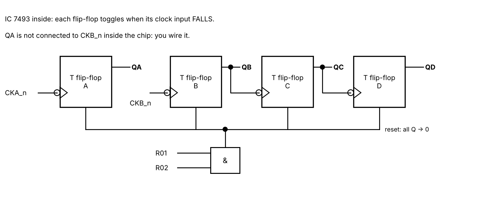
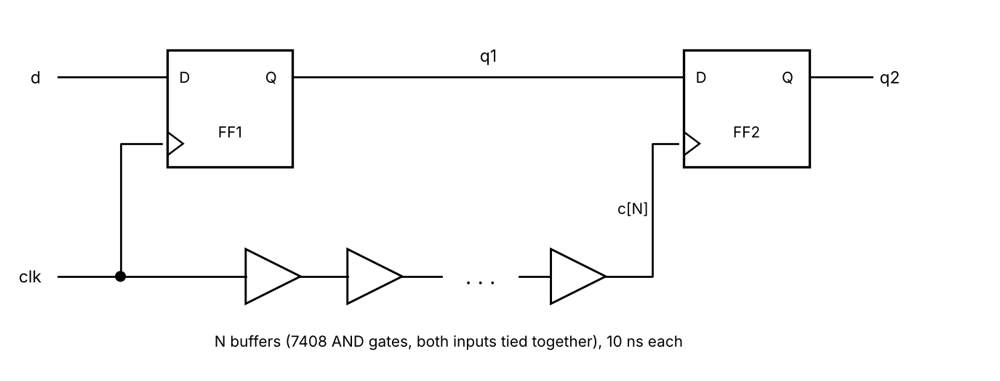

# F215 Digital Design — Lab 3

*Sequential Circuits: Assignments, Synthesis, State Machines, Counters and Timing*

This is a take-home lab with nine tasks. Tasks 1–3 are about writing sequential Verilog. Tasks 4–9 rebuild counter experiments from the hardware lab, wired from 74xx chip models that have real propagation delays. Write your answers to the questions in the `answers.md` file inside each task folder: it is submitted along with your code.

### What you'll take away from this lab

- When `=` and `<=` update a variable, and why that decides how many flip-flops your code describes.
- How to read what a synthesis tool builds from your code: flip-flops, latches, multiplexers.
- The same state machine written two ways: equations you derive by hand (dataflow) and a `case` statement (behavioural).
- How to build and test counters by wiring chips, the way you would on a breadboard.
- Why every real circuit has a maximum clock frequency, and what setup time, hold time and clock skew have to do with it.
- How to write testbenches for clocked circuits.

---

## Before you start

### Testbenches for clocked circuits

A flip-flop samples its input at the clock edge. If the testbench changes that input at the same instant, the simulator has two events at the same time and may process them in either order. Change inputs *away* from the active edge: for a rising-edge circuit, change them on the falling edge (`@(negedge clk) x = ...;`). The given `tb.v` of Task 1 shows the pattern. Use it in every testbench you write.

Every testbench you write must contain the waveform-dump block from Lab 2 (the `$value$plusargs("vcd=%s", ...)` block), or the Run button will not produce a waveform.

### Synthesis: `scripts/synth.sh`

Your codespace now includes **Yosys**, an open-source synthesis tool. To see the circuit a module becomes, run:

```
./scripts/synth.sh labs/lab03/task2/snippets.v sh_nb
```

The first argument is the file. The second is the module, and you can leave it out when the module has the same name as the file. You can also open the file and use **Terminal → Run Task → Synthesize module in current file (Yosys)**. The script prints the cells the module was built from and draws the circuit in `artefacts/synth/<module>.png`.

| Cell | What it is |
|---|---|
| `$dff` | D flip-flop, rising edge |
| `$adff` | D flip-flop with an asynchronous reset pin |
| `$dlatch` | level-sensitive D latch (transparent while its enable is active) |
| `$mux`, `$pmux` | 2-input multiplexer, multiplexer with more inputs |
| `$and`, `$or`, `$not`, `$xor`, `$eq`, `$add`, ... | gates and operators |

A suffix such as `$dff_4` means the cell is 4 bits wide (four flip-flops sharing a clock).

### Chip models: `chips.v`

Tasks 4–9 use `chips.v`, a library of 74xx chip models **with propagation delays and timing checks**. Appendix A lists every chip's pins and timing. In these tasks, build your modules only from chip instances and wires: no `assign` with operators and no `always` blocks. Tie every unused input to `1'b0` or `1'b1`. Every flip-flop powers up as `x` and needs to be cleared first.

---

## Task 1 — Blocking vs. non-blocking in clocked blocks

- **`shift_nb.v`, `shift_b.v`, `shift_b_rev.v`, `shift_3blk.v`** — *given, do not modify (except in part c)*: versions A, B, C, D of what is meant to be a 3-stage shift register (d → q1 → q2 → q3)
- **`swap.v`** — *given*: two registers that should exchange their contents on every clock edge
- **`shift4_nb.v`, `shift4_b.v`** — *skeletons, you write these*
- **`tb.v`** — *given, do not modify*

The testbench sends the serial input d = 1, 0, 1, 1, 0, 0, 1, 0, 0, 0 (one bit per clock) and prints all outputs just after each rising edge.

### (a) Predict, then simulate

Before you run anything, fill this table for versions A, B and C, using the code alone. Write `x` where a value is still unknown.

| Edge | d | A: q1 q2 q3 | B: q1 q2 q3 | C: q1 q2 q3 |
|---|---|---|---|---|
| 1 | 1 | | | |
| 2 | 0 | | | |
| 3 | 1 | | | |
| 4 | 1 | | | |
| 5 | 0 | | | |

Now run the simulation and compare. Correct your table if needed, and explain each correction.

### (b) Which versions are shift registers?

Which of A, B and C behave as a 3-stage shift register? For the one that does not: after every edge, how are q1, q2 and q3 related to each other? What circuit does that code actually describe? (Task 2 will confirm your answer.)

### (c) Version D: a race

Version D puts each blocking assignment in its own `always` block. Run it and note its output. Now reorder the three `always` blocks in `shift_3blk.v` (put the `q3` block first and the `q1` block last), run again, and compare.

1. Did the output change? The Verilog standard does not say in which order blocks triggered by the same edge run. What does that mean for code like version D?
2. Change all three blocks to `<=` and try both orders again. What do you observe, and why?
3. Restore `shift_3blk.v` to the given version.

### (d) Swapping two registers

On edge 1 both modules load a = 3, b = 12. On every later edge they should swap. Predict `a, b` for `swap_nb` and `swap_b` after edges 1–4, then check against the simulation. Explain what goes wrong in `swap_b`.

### (e) Write a 4-stage shift register two ways

- **`shift4_nb.v`**: a 4-stage shift register (d → q[0] → q[1] → q[2] → q[3]) using `<=`.
- **`shift4_b.v`**: the same shift register using **only blocking assignments in a single `always` block**. It must behave exactly like `shift4_nb`.

The testbench prints both (as q[0..3], next to versions A–D). Then answer: if both versions work, why is `<=` still the rule for clocked blocks?

---

## Task 2 — What does the code become? (synthesis)

- **`snippets.v`** — *given, do not modify*: small modules to synthesize
- **`edge_detect.v`** — *given, buggy — fix it*
- **`prio_enc.v`** — *given, buggy — fix it*
- **`tb.v`** — *given, do not modify*: checks `edge_detect` and `prio_enc`

For each part, synthesize the modules named, open the drawing, and copy it as a neat sketch into your answers (gates and flip-flops, not the Yosys boxes word for word).

### (a) The shift registers again

Synthesize `sh_nb`, `sh_b` and `sh_b_rev` (versions A, B, C of Task 1). For each, record how many flip-flops it has and what drives q2 and q3. Does this match your answer to Task 1(b)?

### (b) A temporary variable inside a clocked block

`tmp_first` and `tmp_last` differ only in the order of two lines. Synthesize both and count the flip-flops. Which variable became an extra flip-flop in one of them? From these two cases, state a rule: when does a variable assigned with `=` in a clocked block become a flip-flop?

### (c) Combinational blocks and latches

Synthesize `comb_if`, `comb_case` and `comb_case_default`. Which contain a `$dlatch`? For each latch, give the input value(s) for which the output *holds its old value* instead of following an input.

### (d) Where does the reset go?

Synthesize `cnt_async` and `cnt_sync` and sketch both. Where does `rst_n` connect in each circuit? In which one does the reset take effect immediately, and in which only at the next clock edge? How can you tell from the drawing alone?

### (e) Fix `edge_detect`

`edge_detect` should output `pulse = 1` for exactly one clock cycle each time the button input `btn` goes from 0 to 1 (so that holding the button down counts as one press). Run the testbench: it fails. Synthesize the given module. How many cells does it have, and what does that tell you about what the synthesis tool decided `pulse` is? Explain why. Fix the module, re-run the testbench until `EDGE_DETECT_PASSED`, and re-synthesize. Sketch the fixed circuit.

### (f) Fix `prio_enc`

`prio_enc` is a 4-input priority encoder: `y` is the index of the highest-numbered request line that is 1, and `valid = 1` when any request is 1. With no request, `y = 0` and `valid = 0`. Synthesize the given module, find the latch, and explain where it comes from. Fix the module without changing its ports. Your fix is correct when the testbench prints `PRIO_ENC_PASSED` and the synthesis shows no `$dlatch`.

---

## Task 3 — Sequence detector: dataflow vs. behavioural

A receiver on a serial data line watches for the frame marker **0110**. The line carries one bit per clock on input `x`. The detector is a **Mealy** machine: `y = 1` during the clock cycle in which the last bit of 0110 is on `x`. Patterns may overlap: in 0110110 the marker appears twice.

- **`dff.v`** — *given*: D flip-flop with asynchronous active-low reset
- **`det_df.v`, `det_beh.v`, `det0101_df.v`, `det0101_beh.v`, `det_moore.v`** — *skeletons, you write these*
- **`tb.v`** — *not provided — you write this*

### (a) Dataflow version

Draw the state diagram (4 states) and the state table, choose a binary state encoding, and derive the next-state and output equations with K-maps. Write `det_df.v` using only `assign` statements for the equations and two `dff` instances for the state.

### (b) Behavioural version

Write `det_beh.v` as in the lecture: a state register, a `case` statement for the next state, and output logic.

### (c) Your testbench

Write `tb.v` to test both detectors side by side. It must:

- use a 10 ns clock, hold `rst_n = 0` for the first 12 ns, and change `x` only on falling clock edges;
- send a stream of at least 30 bits containing overlapping markers (0110110), near misses (0111, 0100, 010), and a marker right after reset;
- compute the expected output **independently of your designs**: keep the last bits received in a shift register inside the testbench and compare them with 0110;
- after each new bit, compare both detectors with the expected value, count the mismatches, and print a pass/fail summary at the end.

What initial value should the testbench's history register have so that it cannot report a false marker right after reset?

### (d) The specification changes

The marker is now **0101**. Write `det0101_beh.v` (start from a copy of `det_beh.v`) and `det0101_df.v` (from new K-maps), and extend your testbench to check them too. How many lines did you change in the behavioural version? How much of the dataflow version had to be redone?

### (e) Moore version

Write `det_moore.v`, a **Moore** detector for 0110 (output depends on the state only), and add it to your testbench. Run the simulation and compare `y` of `det_beh` and `det_moore` for the same input in the waveform. How many states does the Moore machine need? How much later does its output rise? Within one clock cycle, which of the two outputs can change when `x` changes?

---

## Task 4 — Ripple counters with IC 7493



The 7493 holds four toggle flip-flops. Flip-flop A is clocked by pin `CKA_n`; B by pin `CKB_n`; C by QB and D by QC. All of them toggle on the **falling** edge of their clock. When R01 and R02 are both 1, all four flip-flops clear. Each flip-flop takes 15 ns from its clock edge to its output (Appendix A).

- **`chips.v`** — *given*
- **`counter16.v`** — *skeleton, you write this*: 0–15 counter, one 7493 and nothing else
- **`bcd_counter.v`** — *skeleton, you write this*: 0–9 counter, one 7493 plus gates
- **`tb.v`** — *given (you only change `T` in part d)*: reads both counts 1 ns before each counting edge

Both counters must also clear while `rst = 1`.

### (a) Mod-16 counter

Write `counter16.v` and run the testbench. From the waveform, give the period of QA, QB, QC and QD in terms of the clock period. What is this circuit useful for apart from counting?

### (b) BCD counter

Write `bcd_counter.v`. It must clear itself when the count reaches 10, and also when `rst = 1`. Run until the testbench prints `ALL_TASK4_COUNTS_CORRECT`.

### (c) Zoom in on a counting edge

Zoom into the waveform at the falling clock edge where `counter16` goes from 7 to 8. List every value the count passes through, with the time of each change measured from the clock edge. Do the same for `bcd_counter` going from 9 to 0. How long does the value 10 appear on the BCD counter's outputs? A circuit decodes "count = 8" from `counter16` to switch on a lamp. Find every transition of `counter16` during which 8 appears for a moment, and say for how long.

### (d) How fast can a ripple counter go?

Change `parameter T` in `tb.v` and find the smallest period for which each counter is still read correctly (the testbench reports wrong counts separately for each counter). Find the limit for `counter16` and for `bcd_counter`. Explain both numbers from the delays in Appendix A. Why does the BCD counter need a longer period? Set `T` back to 400 when you are done.

---

## Task 5 — Synchronous counter from D flip-flops

- **`chips.v`** — *given*
- **`sync_counter4.v`** — *skeleton, you write this*: 4-bit synchronous up counter (0, 1, 2, ..., 15, 0, ...)
- **`tb.v`** — *given*

### (a) Design

Write the state table of a 4-bit binary up counter built from D flip-flops, and derive the four D input equations. Draw the circuit using chips from `chips.v` (7474 flip-flops and gate chips of your choice), then write `sync_counter4.v`. Every flip-flop is clocked by `clk` and cleared by `clr_n`.

### (b) Compare with the ripple counter

Run the testbench. Zoom into the edge where the count goes from 7 to 8: how many ns after the clock edge do the outputs change, and do they change together? Compare with your list from Task 4(c).

### (c) The longest path

In your circuit, find the slowest path from a flip-flop's clock edge, through its output and the gates, to some flip-flop's D input. How long after the clock edge does the last D input settle? You will need this number in Task 8.

---

## Task 6 — Irregular counter with JK flip-flops

The hardware lab built a counter with the irregular sequence **001 → 010 → 101 → 111 → 001 → ...** (q = Q2 Q1 Q0). Here you build it with the 74112 JK flip-flop (falling edge) and test what happens when it starts in one of the four states that are not in the sequence.

- **`chips.v`** — *given*
- **`irr_counter.v`** — *skeleton, you write this*
- **`tb.v`** — *not provided — you write this*

### (a) Design

Design the counter with JK flip-flops, using the unused states as don't cares. Write `irr_counter.v`. Connect `pre_n[i]` and `clr_n[i]` directly to the PRE_n and CLR_n pins of the flip-flop that drives `q[i]`, so that a testbench can force any state.

### (b) Your testbench

Write `tb.v` so that it:

- forces each of the 8 states in turn through `pre_n` and `clr_n`. Change them only while the clock is high, hold them for at least 50 ns, then release;
- applies 5 clock pulses after each forced state and prints the states visited, one line per starting state.

Run it and check that the sequence from 001 is correct.

### (c) Self-correction

From your printout, draw the complete state diagram including the four unused states. Is your counter self-correcting (does every unused state reach the main sequence)? How many pulses does the slowest one take? If your counter is not self-correcting, change your don't-care choices so that it is, and re-run.

---

## Task 7 — Seconds counter 00–59

A digital clock counts seconds from 00 to 59, then wraps to 00. Build it from two 7493s (units digit 0–9, tens digit 0–5) and gates. One clock pulse is one second.

- **`chips.v`** — *given*
- **`mod60.v`** — *skeleton, you write this*
- **`tb.v`** — *given*

### (a) Design

Write `mod60.v`. Decide what clocks the tens counter: which units output has a falling edge exactly once per 10 seconds, at the moment the units go from 9 to 0? Both digits must clear while `rst = 1`.

### (b) The 59 → 00 edge

Run the testbench. Zoom into the clock edge where the display goes from 59 to 00. List every value the display (tens, units) passes through, with times measured from the clock edge. How long after the edge does the display settle? Using the same rule as Task 4(d), what is the smallest clock period this counter could handle? (Check your answer by changing `T`, then set it back to 400.)

---

## Task 8 — Maximum clock frequency of a synchronous counter

- **`chips.v`** — *given*
- **`sync_counter4.v`** — *copy your file from Task 5, unchanged*
- **`tb.v`** — *not provided — you write this*

### (a) Predict

A flip-flop's D input must be stable at least t<sub>su</sub> before the clock edge. Using your longest path from Task 5(c), predict the smallest clock period T<sub>min</sub> at which `sync_counter4` still counts correctly, and the corresponding maximum frequency.

### (b) Write a frequency-sweep testbench

Write `tb.v` that tries every period T from 100 ns down to 40 ns in 1 ns steps. For each T it must:

- stop the clock, clear the counter, and release the clear;
- apply 20 rising clock edges with period T. Drive the clock directly in a loop (set `clk`, wait `T/2.0`, and so on) rather than with an `always` block, so that T can change between runs;
- check just before each next edge that the count went up by exactly 1 (an `x` counts as wrong);
- print one line per T, with PASS or FAIL.

At the end it must print exactly one line of the form

```
RESULT: Tmin = <smallest passing period> ns
```

The autograder looks for this line.

### (c) Compare

Does your measured T<sub>min</sub> match the prediction from part (a)? At the first period that fails, which flip-flop fails first and what message does the simulator print? Explain the message using the numbers in Appendix A.

### (d) Ripple or synchronous?

Compare your result with the ripple counter's limit from Task 4(d). If both counters were extended to 16 bits, estimate T<sub>min</sub> for each (assume the synchronous counter keeps the same kind of gate chain that you used). Which design gets slower as bits are added, and why?

---

## Task 9 — Hold time and clock skew

On a large circuit board or chip, the clock reaches different flip-flops at slightly different times, because the wires and buffers carrying it delay it. This difference is called **clock skew**. Here you add skew on purpose and watch it break a shift register.



- **`chips.v`** — *given*
- **`skew_shift.v`** — *skeleton, you write this*
- **`tb.v`** — *given*: five copies, N = 0 to 4, side by side

### (a) Build it

Write `skew_shift.v`: two 7474 flip-flops in a shift register. Flip-flop 1 is clocked by `clk`. Flip-flop 2 is clocked by `clk` passed through **N** buffers, each a 7408 AND gate with both inputs tied together. Build the chain of buffers with a `generate` loop over the parameter N (N = 0 means no buffers).

### (b) Predict, then simulate

For each N from 0 to 4, take the clock edge at flip-flop 1 as time 0. When does the edge reach flip-flop 2? When does q1 change? Then predict, for each N, whether flip-flop 2 sees a hold violation, a setup violation, or no violation, and whether q2 comes out correct. Fill this table, then run the testbench and check it:

| N | edge at FF2 (ns) | q1 changes at (ns) | violation? | q2 correct? |
|---|---|---|---|---|
| 0 | | | | |
| 1 | | | | |
| 2 | | | | |
| 3 | | | | |
| 4 | | | | |

One of these cases gives wrong data with **no warning at all**. Which one, and what does q2 do there?

### (c) The rule

Write the condition on the skew t<sub>skew</sub> for this shift register to work, in terms of t<sub>pcq</sub> and t<sub>h</sub>. Would a slower clock fix N = 2? Why or why not?

### (d) The other direction

Suppose the N buffers delayed the clock of flip-flop **1** instead of flip-flop 2. What would happen for N = 4? What does this choice cost instead? (Hint: think about the setup condition from Task 8.) You may test it on a copy of your module, but submit the version described in part (a).

---

## Appendix A — Chips in `chips.v`

Pin names follow the data sheets. `_n` marks an active-low pin.

| Chip | Function | Ports |
|---|---|---|
| `ic7400` | quad 2-input NAND | `A1,B1,...,A4,B4` → `Y1..Y4` |
| `ic7402` | quad 2-input NOR | `A1,B1,...,A4,B4` → `Y1..Y4` |
| `ic7404` | hex inverter | `A1..A6` → `Y1..Y6` |
| `ic7408` | quad 2-input AND | `A1,B1,...,A4,B4` → `Y1..Y4` |
| `ic7410` | triple 3-input NAND | `A1,B1,C1,...,A3,B3,C3` → `Y1..Y3` |
| `ic7432` | quad 2-input OR | `A1,B1,...,A4,B4` → `Y1..Y4` |
| `ic7486` | quad 2-input XOR | `A1,B1,...,A4,B4` → `Y1..Y4` |
| `ic7474` | dual D flip-flop, rising edge | `D1,CLK1,PRE1_n,CLR1_n, D2,CLK2,PRE2_n,CLR2_n` → `Q1,Q1_n,Q2,Q2_n` |
| `ic74112` | dual JK flip-flop, falling edge | `J1,K1,CLK1,PRE1_n,CLR1_n, J2,K2,CLK2,PRE2_n,CLR2_n` → `Q1,Q1_n,Q2,Q2_n` |
| `ic7493` | 4-bit ripple counter (figure in Task 4) | `CKA_n,CKB_n,R01,R02` → `QA,QB,QC,QD` |

| Timing | Value |
|---|---|
| Every gate: input change → output | 10 ns |
| 7474, 74112: active clock edge → Q (t<sub>pcq</sub>) | 20 ns |
| 7474, 74112: setup time (t<sub>su</sub>) | 15 ns |
| 7474, 74112: hold time (t<sub>h</sub>) | 5 ns |
| 7474, 74112: PRE_n / CLR_n → Q | 20 ns |
| 7493: each internal flip-flop, its clock edge → its Q | 15 ns |
| 7493: R01 = R02 = 1 → all Q = 0 | 20 ns |

If a flip-flop's D (or J, K) input changes less than t<sub>su</sub> before, or less than t<sub>h</sub> after, its active clock edge, the flip-flop cannot decide: its Q becomes `x` and the simulator prints a `SETUP violation` or `HOLD violation` message naming the flip-flop. A real flip-flop would not print anything. It would go to 0 or 1 unpredictably, and could take an unusually long time to settle.
